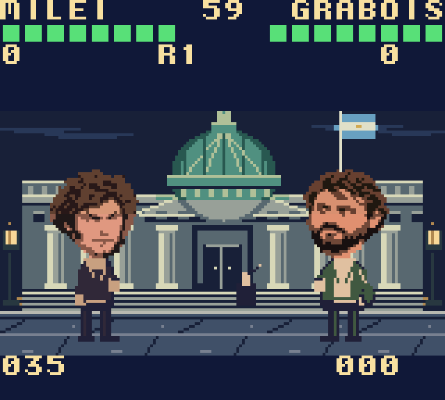

# Rosca Kombat

Un juego de pelea satírico y open source para **Game Boy Color y ModRetro Chromatic**: 32 egos, una silla. ROM original de 256 KiB. Código y recursos originales disponibles bajo [licencia MIT](LICENSE); componentes de terceros detallados en [THIRD_PARTY_NOTICES.md](THIRD_PARTY_NOTICES.md).

[Descargar ROM](build/rosca-kombat.gbc) · [Plantel y poderes](docs/plantel.md) · [Arte y prompts](docs/arte-personajes.md)



La versión visual **1.2** reemplaza las caras genéricas por 32 retratos individuales. El selector muestra retratos nativos de **64×80 píxeles**, con hasta siete paletas por retrato. En combate, las cabezas pasan de 24×16 a **32×32 píxeles** y usan las mismas caras del selector: melena y patillas de Milei, pelo rojizo de CFK, bigotes de Alfonsín y Alberto, rulos de Lousteau, caras distintas para Larreta y Espert. Los luchadores ocupan 32×64 píxeles y conservan las seis poses y las posiciones de manos y pies. El dibujo usa las rutinas de metasprites de GBDK; dos proyectiles simultáneos usan una variante compacta para respetar el límite de diez sprites por línea del hardware.

Los cuatro escenarios conservan su arquitectura, iluminación y paletas: Congreso, Casa Rosada, Obelisco y obra. `build/roster-gallery.png`, `build/fighters-in-rom.png` y `build/arenas-gallery.png` son capturas de la ROM real. Los originales de arte están en `assets/portraits/`; su procedencia y dirección visual se documentan en `docs/arte-personajes.md`.

## Jugar ahora

En esta computadora, abrir **`Jugar en PC.cmd`**. Ejecuta la ROM real en PyBoy en una ventana, con sonido.

| Teclado en PC | Botón de la consola |
| --- | --- |
| Flechas | Cruceta |
| X | A |
| Z | B |
| Retroceso | SELECT |
| Enter | START |

Para jugar en la consola, conectar el Chromatic encendido con un cable USB-C de datos y abrir **`Jugar en Chromatic.cmd`**. Transmite el juego durante 30 minutos mediante la CLI oficial; requiere mantener el cable conectado. No reemplaza el juego del cartucho. También se puede iniciar por terminal:

```powershell
npm run play:chromatic -- 1800
```

La ROM está en **`build/rosca-kombat.gbc`** y puede abrirse con un emulador de Game Boy Color. La transmisión USB y el uso de un cartucho son formas distintas de jugar; este proyecto prepara la transmisión y entrega la ROM, sin flashear cartuchos.

## Controles de combate

| Control | Acción |
| --- | --- |
| Izquierda / derecha | Caminar |
| Arriba | Saltar; permite cruzar al rival y esquivar proyectiles |
| Abajo, mantenido | Bloquear y agacharse; los especiales hacen daño reducido |
| A | Puñetazo |
| B | Patada, con mayor alcance |
| SELECT o abajo + B | Especial del personaje, cuesta 35 de poder |
| A + B, juntos | Súper, requiere 100 de poder |
| START | Pausa; SELECT activa o silencia la música durante la pausa |
| Abajo + B, en pausa | Volver a la portada |

La barra verde indica vida; el número inferior indica poder. Los golpes y los bloqueos cargan poder. Cada pelea es al mejor de tres rounds de 60 segundos del juego. Un empate repite el round. Después del segundo KO, el ganador dispone de una ventana para hacer su remate con SELECT o A+B. Los remates son gags de caricatura, sin gore.

## Qué trae

- **32 personajes**, incluido el Pato de Goma como bonus. Plantel y poderes completos en [docs/plantel.md](docs/plantel.md).
- Macri con globos, Carrió con expedientes, Eva con corazones, Grabois con un mate molotov de caricatura, Bullrich con nube antipiquete, Beltrán Briones con casco de obra y ladrillo, un piquetero con adoquín y un uniformado con silbato. También Milei, CFK, Perón, Menem, Alfonsín, Néstor, Alberto, Massa, Kicillof, Bregman y más.
- Seis familias de especiales: proyectil directo, objeto pesado con arco, ataque rápido, curación, objeto que cae desde arriba y nube lenta. Cada personaje tiene nombre, colores, objeto, velocidad y potencia propios; varios comparten familia y poses base.
- Cuatro escenarios: Congreso, Casa Rosada, Obelisco y Obra en Pozo.
- Duelo con selección libre del rival y torneo de ocho peleas.
- Tres niveles: Tranqui, Picante e Imposible. Cambian la frecuencia de ataque, la defensa y la evasión de la CPU.
- Música original en bucle, sonidos de golpes, combos, pausas y revancha.

Todo es ficción humorística. Los poderes, diálogos y remates no describen hechos reales ni expresan apoyo político. Las referencias de las capturas se adaptaron a caricaturas. No usa gráficos, audio ni código de Mortal Kombat. En esta versión se juega contra la CPU; no hay multijugador ni guardado de progreso. Los remates comparten una secuencia visual con el objeto y el texto del personaje.

## Compilar y verificar

Requisitos: **Node.js 20 o posterior**, **GBDK-2020 4.5.0** y, para las pruebas o el emulador de PC, **Python 3.12**. El repositorio no incluye compiladores ni paquetes de Python. No se necesitan credenciales de OpenAI ni generar imágenes para compilar: el arte convertido está incluido.

1. Descargar GBDK 4.5.0 desde sus [releases oficiales](https://github.com/gbdk-2020/gbdk-2020/releases/tag/4.5.0). En Windows, extraer `gbdk-win64.zip` de modo que exista `tools/gbdk/bin/lcc.exe`. En macOS/Linux, usar el paquete de la plataforma y `tools/gbdk/bin/lcc`.
2. Para usar otra instalación, definir `GBDKDIR` con la ruta de la carpeta GBDK. `GBDK_LCC` permite indicar el ejecutable por separado.
3. Ejecutar desde la raíz del proyecto:

```powershell
npm run build
python -m pip install --target tools/python-packages -r requirements-test.txt
npm test
```

Node no necesita `npm install` para compilar. El resultado es `build/rosca-kombat.gbc`, junto con su SHA256. En Windows los lanzadores usan `python`; en macOS/Linux, `python3`. También se reconoce el Python del entorno de Codex si está instalado. Para elegir otro intérprete, definir `CHROMATIC_PYTHON`. Por ejemplo, en PowerShell:

```powershell
$env:CHROMATIC_PYTHON = "C:/Python312/python.exe"
$env:GBDKDIR = "C:/gbdk/"
npm run build
```

Para jugar en PC, ejecutar `npm run play:pc`. La transmisión a Chromatic requiere instalar aparte la [CLI oficial](https://www.npmjs.com/package/@modretro/chromatic-cli) y definir `CHROMATIC_CLI` con su ejecutable, o colocarlo en `tools/chromatic-cli.exe`.

`scripts/make-assets.mjs` empaqueta gráficos y plantel; `scripts/character-art.mjs` lee las caras y poses preconvertidas de `assets/portraits/cgb-art.json`; `scripts/stage-art.mjs` dibuja los escenarios. Cada luchador usa dos paletas para la cabeza y una para el cuerpo. `src/main.c` contiene el combate, la CPU y los menús. Los bancos 2–9 contienen poses y retratos, el 10 los escenarios y objetos, y el 11 el plantel, colores y metasprites. La compilación comprueba que el código y los manejadores de interrupciones caben en el banco fijo, además de las sumas de comprobación de la ROM.

Las pruebas ejecutan la ROM compilada: 90 comprobaciones de selección, combate, poderes, CPU, pausa, rounds y torneo, más 803 comprobaciones de retratos, poses, orientación y límites de sprites por línea. Los informes `build/playtest.json` y `build/likeness-check.json` incluyen el SHA256 de la ROM probada. Algunos escenarios de prueba fijan posiciones y vida mediante símbolos de depuración para comprobar casos concretos. Ejecutar `npm run build` antes de `npm test` para generar esos símbolos.

`scripts/visual-review.py` recorre los 32 retratos y captura los cuatro escenarios y las seis poses desde el emulador para revisar color, visibilidad y composición. Para regenerar el arte convertido desde los atlas incluidos, usar `npm run art:pack` y luego `npm run build`; requiere Pillow y NumPy.

**Hardware:** esta versión se transmitió por USB a un Chromatic conectado mediante la CLI oficial, que confirmó el estado `running`. Las comprobaciones automáticas de combate y gráficos se ejecutaron en PyBoy. La transmisión USB ejecuta un emulador y envía video/audio/controles; esta entrega no certifica una prueba autónoma desde un cartucho flasheado.

## Estructura y contribuciones

- `src/main.c`: lógica del juego.
- `scripts/`: generadores de arte, compilación, emulador y pruebas.
- `assets/portraits/`: atlas originales, retratos separados y gráficos CGB convertidos.
- `docs/`: plantel, procedencia del arte, prompts y ficha de presentación.
- `build/`: ROM distribuida, capturas e informes de la versión 1.2.0.

Para proponer cambios, modificar los generadores o las fuentes originales, regenerar los archivos C cuando corresponda, compilar y ejecutar las pruebas. No incluir `tools/`, dependencias instaladas, credenciales ni archivos locales de respaldo en contribuciones.

Herramientas: [GBDK](https://gbdk.org/docs/api/), [PyBoy](https://docs.pyboy.dk/) y [CLI oficial de ModRetro](https://www.npmjs.com/package/@modretro/chromatic-cli). Referencia de conexión: [guía de Chromatic DevDay](https://support.modretro.com/en_us/chromatic-devday-edition-quickstart-guid-By1iOlcMg).
